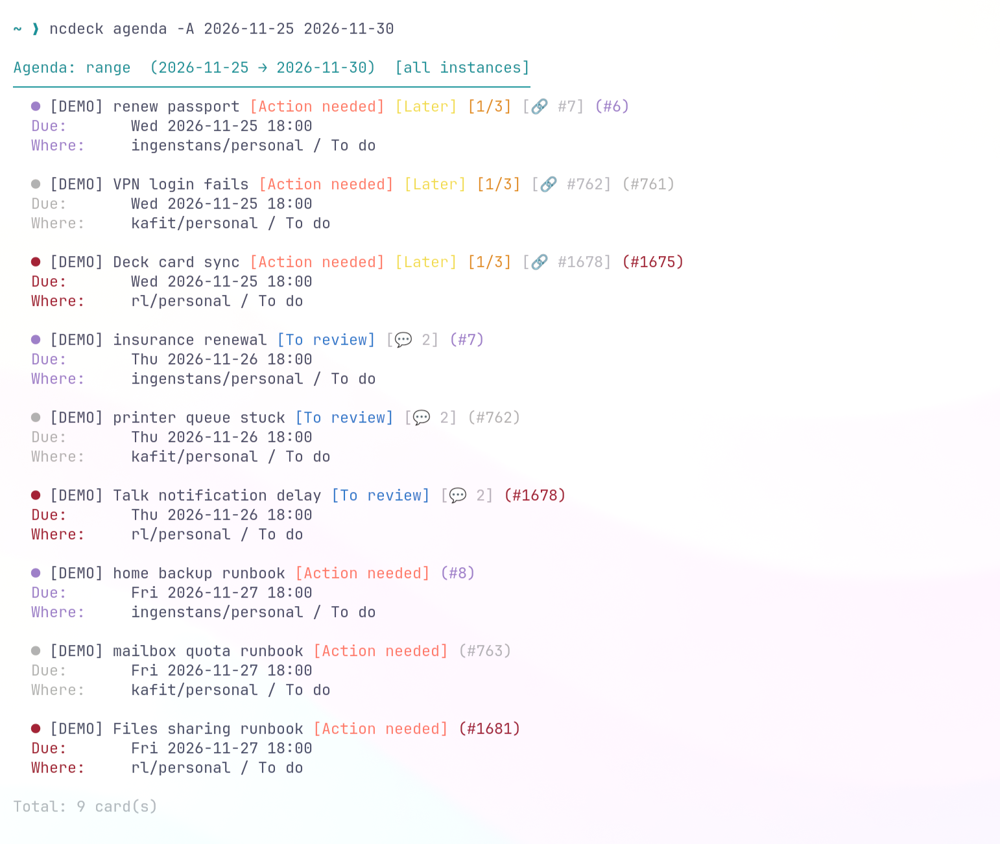
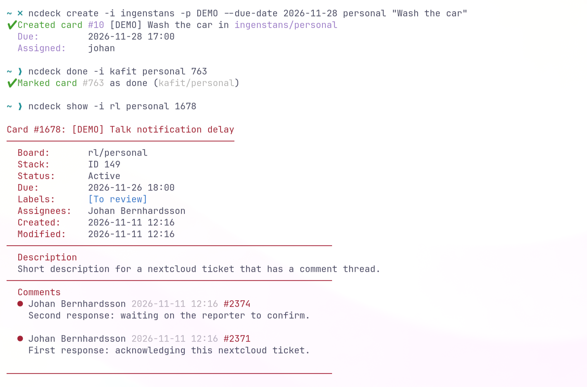
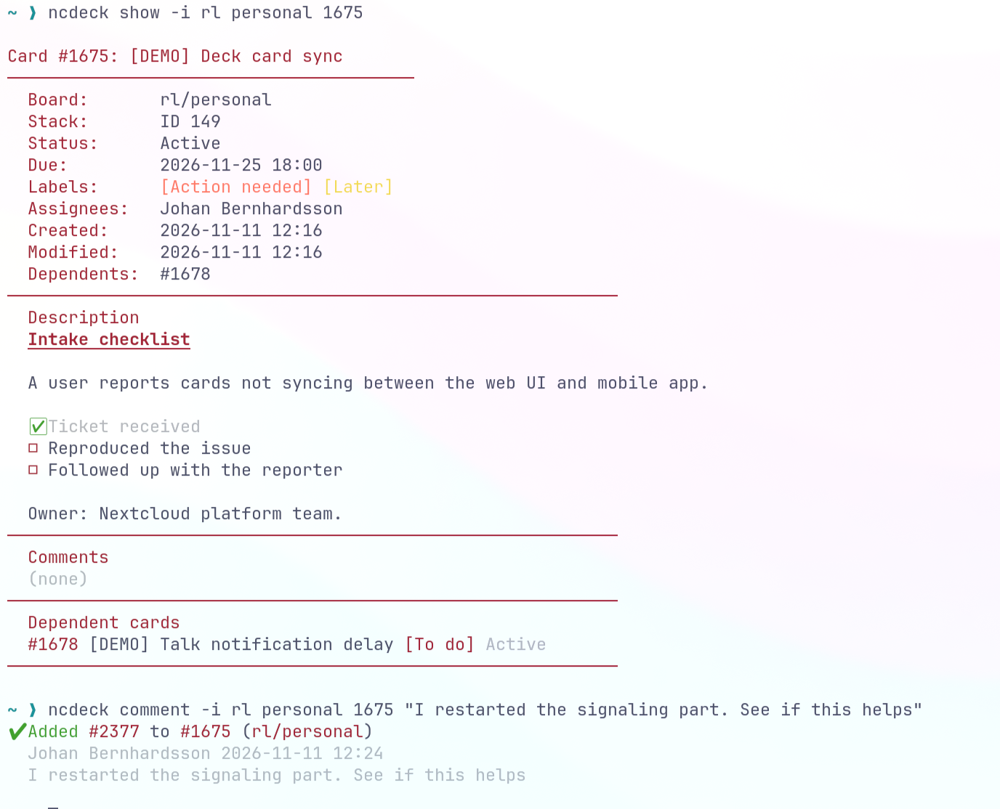

# ncdeck

A lightweight CLI for [Nextcloud Deck](https://apps.nextcloud.com/apps/deck) that lets you create and manage cards across multiple Nextcloud instances without leaving the terminal.

## Showcase

A few glimpses of `ncdeck` in action (captured in [Ghostty](https://ghostty.org/)).

### Agenda across every instance

`ncdeck agenda -A 2026-11-25 2026-11-30` — colored labels, task-list counters, comment counters, dependency links, due dates, and a distinct color per instance.



### Create, complete, inspect

`ncdeck create`, `ncdeck done`, and `ncdeck show` — a card's details, labels, assignees, and its comment thread.



### Rich card details

`ncdeck show` renders Markdown descriptions (headings, checklists, links), lists dependent cards, and `ncdeck comment` adds to the conversation.



## What it can do

- **Create rich cards** — titles with prefixes, due dates (`today`, `tomorrow`, `2026-11-11`, or full timestamps), tags by name, descriptions from inline text / files / stdin, assignees, and file attachments.
- **Work with existing cards** — mark done (and move to a done stack), move between stacks, assign/unassign users, add comments, set or amend descriptions, and attach files.
- **See everything at a glance** — `list --cards`, `search`, and `show` display assignees, due dates, colored label chips, task-list counters (`[done/total]`), comment counters (`[💬 n]`), dependencies (`[🔗 #id]`), and prominent `OVERDUE` / `DONE` status. In a terminal, `show` also renders descriptions and comments as Markdown (use `--raw` for the source).
- **Plan your day** — `agenda yesterday|today|tomorrow|week|month`, an exact `YYYY-MM-DD` date, or a `START END` range (with `-A` for all instances); `today` also surfaces overdue cards from earlier days. Plus the interactive `completed` review.
- **Multiple instances** — one config, short board/instance names, per-instance theme colors, cached labels (with colors), and shared-board filtering.
- **Board aliases** — give a board a short alias (e.g. `DW` for `Digital Workplace`) and use it anywhere a board key is accepted; `ncdeck list --boards` shows each real board name next to its mapped name and alias.
- **Bulk cleanup** — `archive BOARD BEFORE_DATE` to archive old done cards.

## Quick Start

### Installation

**Option A — prebuilt binary (no Python needed)**

Download `ncdeck-<os>-<arch>` from the [Releases](https://github.com/small1/ncdeck-cli/releases) page, then:

```bash
chmod +x ncdeck-linux-x86_64
sudo mv ncdeck-linux-x86_64 /usr/local/bin/ncdeck
ncdeck --version
```

Binaries are built for Linux (x86_64), macOS (x86_64 + arm64), and Windows
(x86_64) on every `v*` tag. The Linux build targets glibc ≥ 2.35. The binary
is self-contained — no Python, pip packages, or external tools such as `curl`
are needed. See [THIRD_PARTY_NOTICES.md](THIRD_PARTY_NOTICES.md) for bundled
components and licenses.

**Option B — from source (Python 3.9+)**

```bash
pip install .
```

Or for development:

```bash
pip install -e .
```

To build your own standalone binary locally:

```bash
make binary      # creates dist/ncdeck (or dist/ncdeck.exe)
```

### Configuration

There are two ways to add accounts.

**1. Automatic — `ncdeck account add` (primary and easiest)**

This is the recommended way. It uses Nextcloud Login Flow v2: a browser opens for you to approve the login, then `ncdeck` auto-discovers boards, stacks, labels (with colors), the done stack, and the instance theme color. It prompts you for short names and an optional alias per board, stores the real board name, and merges everything into your config — no manual ID hunting and no app password to paste.

```bash
ncdeck account add

# Optionally pre-fill the server URL and short instance name
ncdeck account add --url https://cloud.example.com -i work
```

**2. Manual**

Create `~/.config/ncdeck/config.yaml` yourself (see [config.example.yaml](config.example.yaml)):

```yaml
default_instance: work
instances:
  work:
    url: https://nextcloud.example.com
    username: alice
    password: app-password-here
    boards:
      inbox:
        board_id: 1
        stack_id: 5
        done_stack_id: 10
      bugs:
        board_id: 2
        stack_id: 9
        board_title: Bug Tracker
        alias: BT
```

A board can have a short `alias` (or an `aliases` list). Use it anywhere a board key is accepted:

```bash
ncdeck config alias work bugs BT          # set / replace an alias
ncdeck config alias work bugs             # show the current alias
ncdeck config alias work bugs --clear     # remove it
ncdeck list --boards -i work             # real name -> mapped name + alias
ncdeck list --cards BT -i work
```

See [README_FULL.md](README_FULL.md) for every config option, `ncdeck account list/delete`, and `ncdeck config color/alias`.

### Usage

```bash
# See what is configured (real board names + mapped names/aliases)
ncdeck list --boards
ncdeck account list
ncdeck labels inbox

# Create a card (aliases work anywhere a board key does)
ncdeck create inbox "Fix login bug" -p "[BUG]" -t bug --due-date tomorrow
ncdeck create BT "Another bug" -p "[BUG]"
```

## More examples

### Cards

```bash
# Prefix, due date, tags, description, and assignee
ncdeck create inbox "Fix login bug" -p "[BUG]" --due-date 2026-11-11 -t bug -t critical -d "Fails on Safari" -a alice

# Description from a Markdown file, plus an attachment
ncdeck create bugs "Crash on upload" -f ./crash-report.md --attach ./debug.log

# Inspect
ncdeck list --cards inbox
ncdeck show inbox 123
ncdeck search inbox "login"

# Update
ncdeck description inbox 123 --amend "Follow-up: fixed in 18.1"
ncdeck comment inbox 123 "Waiting on QA"
ncdeck assign inbox 123 bob
ncdeck attach inbox 123 ./screenshot.png
ncdeck move inbox 123 7
ncdeck done inbox 123
```

### Agenda and planning

```bash
# Review what was due yesterday (handy for items you forgot to close or move)
ncdeck agenda yesterday

# Due today - also includes open cards overdue from earlier days
ncdeck agenda today

# Tomorrow, the next 7 days, or the next 30 days
ncdeck agenda tomorrow
ncdeck agenda week
ncdeck agenda month

# An exact date, or an inclusive date range
ncdeck agenda 2026-11-15
ncdeck agenda 2026-11-10 2026-11-20

# Across every configured instance / include unassigned cards on shared boards
ncdeck agenda today -A
ncdeck agenda week --all

# Focus on one instance
ncdeck agenda today -i work

# Interactive daily review: mark selected cards done, push the rest to tomorrow
ncdeck completed
ncdeck completed -A

# Archive done cards older than a date
ncdeck archive inbox 2026-01-01 -y
```

See [README_FULL.md](README_FULL.md) for complete documentation.

## License

GPL-3.0-only. See [LICENSE](LICENSE).
